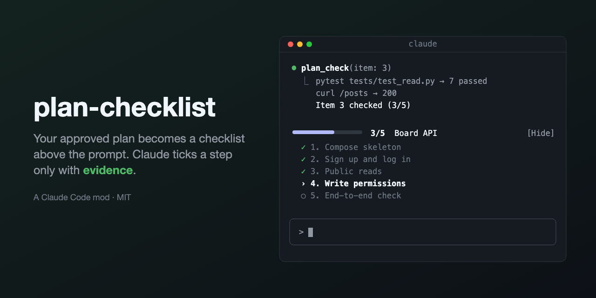

# plan-checklist



A Claude Code mod that turns the plan you approve in plan mode into a todo list, and lets Claude check a step off only when it shows how it verified it.

```
━━━━────────  1/3  Next  Fix the refund logic          [Show all]
```

## Install

At the prompt of a Claude Code terminal session:

```
/plugin install plan-checklist --marketplace Jh-jaehyuk/plan-checklist
```

Answer `y` to add the marketplace, then pick a scope (user scope loads it in every session). It is active right away.

## How it works

1. **Approve a plan.** When you accept a plan in plan mode, its steps become a todo list. The steps are the plan's checkboxes; if there are none, its top-level numbered list; failing that, its top-level bullets.
2. **Watch progress above the prompt.** A one-line band shows the progress bar and the step Claude is on. Press **Show all** to see every step, and **Hide** to collapse it again.
3. **Claude checks steps with evidence.** Claude marks a step done through the `plan_check` tool, and must say which verification it ran and what came out (for example `pytest tests/test_refund.py → 12 passed`). A check without real evidence is refused. Only the main agent checks: any other agent (a subagent, a teammate, a workflow agent) is refused and reports its evidence instead, and the main agent verifies it before checking the step.
4. **Nothing gets forgotten.** Every turn, Claude is reminded of the remaining steps. The list survives `/compact`, and `/clear` wipes it.

When every step is checked you get a toast and the bar turns green.

## Commands

| Command | What it does |
| --- | --- |
| `/checklist` | Lists every step with the evidence Claude gave for it |

## Settings

| Option | Values | Default |
| --- | --- | --- |
| `language` | `en`, `ko` | `en` |

Change it from `/config`, or in `settings.json`:

```json
{ "pluginConfigs": { "plan-checklist": { "options": { "language": "ko" } } } }
```

The language applies to the band, the toasts, `/checklist` and the reminder Claude reads.

## Limits

- A resumed session (agent view's ←, `--resume`, `/resume`) or a branch (`/branch`) rebuilds the list from its transcript, so a plan approved more than 4096 messages back is not found.
- A plan without checkboxes, a numbered list or bullets has no steps to track; you get a toast saying so.
- At most 20 steps are tracked.

## Privacy

plan-checklist sends nothing outside Claude Code. It makes no network requests and writes no files: the plan lives in the session's state, and a resumed session rebuilds it from its own transcript.

## Contributing

See [CONTRIBUTING.md](CONTRIBUTING.md). Changes are listed in [CHANGELOG.md](CHANGELOG.md).

## License

MIT
